<div align="center">
  <a href="https://www.lucasleite.us"></a>
</div>

### `❯ cat about.txt`

```text
control & automation engineer who fell into software in 2013 and never climbed back out.
started with robots and drones. scaled a startup to hundreds of thousands of users.
ended up principal engineer on platforms for one of america's most iconic brands.
still builds robots. now also builds the things that build the things:
agents, dev tooling, and the occasional iron man suit.
```

### `❯ git log --career --graph`

```diff
@@ 2023 ── 2026 @@  principal software engineer
+ principal engineer on a global marketing & sales planning platform
+ 99.99% uptime · 150+ monthly active users across global teams
+ owned roadmap + architecture with directors and PMs, mentored the team
+ phoenix liveview component system -> faster, more consistent front end
+ agentic ai in prod: claude agent sdk · mcp · llm agents · vector search

@@ 2020 ── 2023 @@  senior full-stack engineer
+ end-to-end product work for an iconic american brand
+ react · python · django · kubernetes · aws · terraform · snowflake

@@ 2020 @@  senior full-stack engineer · edtech
+ e-learning tools that teach people to code, at a public edtech company
+ live chat for students, salesforce sync, g suite -> o365 migration
+ django apis, react/redux, node + serverless lambdas on aws

@@ 2014 ── 2019 @@  startup years
+ restaurant platform: digital menus in 100+ languages, ordering, payments
+ customer-feedback saas: zero -> thousands of daily users
+ fantasy-soccer app for a brazilian série a club
+ enterprise saas with active directory / ldap sign-on

@@ 2013 ── 2019 @@  founder · hardware + software lab
+ shipped software for hundreds of business clients
+ drone payload that sprays mosquito nests (yellow fever, malaria, chikungunya)
+ park-cleaning robot in c + python -> 1st place worldwide, robotics engineering
+ embedded: microcontrollers, eagle cad, solidworks, 3d printing

@@ 2013 ── 2019 @@  b.eng. control & automation engineering
```

### `❯ ls ~/side-quests`

|     | project                                                                        | what it is                                                                                         |
| :-: | ------------------------------------------------------------------------------ | -------------------------------------------------------------------------------------------------- |
| 🥔  | [**age-of-potatoes**](https://github.com/melucasleite/age-of-potatoes)         | browser factory/farming tycoon on a deterministic sim. [play it →](https://ageofpotatoes.com)      |
| 🔊  | [**claude-tts**](https://github.com/melucasleite/claude-tts)                   | claude code narrates its work out loud. offline neural tts, piper + ffmpeg                         |
| ⭕  | [**claude-usage-widget**](https://github.com/melucasleite/claude-usage-widget) | your claude code limits as apple-watch activity rings, with a forecast                             |
| 🦾  | [**mark85**](https://github.com/melucasleite/mark85)                           | iron man suit firmware: 4 limb imus -> stereo servo whir + repulsor charge-up on an esp32-s3       |
| 🍳  | [**mini-kitchen**](https://github.com/melucasleite/mini-kitchen)               | toddler play kitchen with a sink that actually runs. cnc oak, 12 v pump, python-generated cut list |
| 🧊  | [**speedster**](https://github.com/melucasleite/speedster)                     | dark-mode speedcubing timer for ios                                                                |

### `❯ which --all`

<p>
  
  <br>
  
</p>

### `❯ snake --eat contributions`

<picture>
  <source media="(prefers-color-scheme: dark)" srcset="https://raw.githubusercontent.com/melucasleite/melucasleite/output/snake-dark.svg">
  <source media="(prefers-color-scheme: light)" srcset="https://raw.githubusercontent.com/melucasleite/melucasleite/output/snake.svg">
  
</picture>

### `❯ exit`

```text
[process completed]  ·  www.lucasleite.us
```

<a href="https://www.lucasleite.us"></a>

